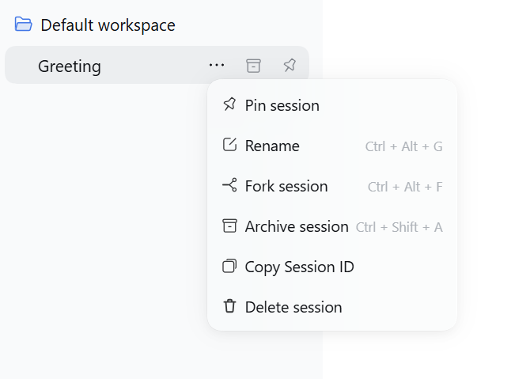
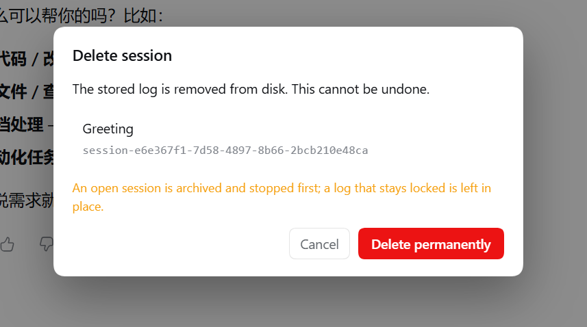

# dsh-session-delete

在侧栏会话管理里新增「删除会话」，并提供 `/delete` 命令删除当前会话。两者都把会话日志从磁盘真正删掉（不是归档）。DSH 本身只提供归档、没有删除接口，本插件直接操作会话存储目录，属于非常规操作——请先读完「限制」。

## 用法

- **侧栏菜单**：会话行「⋯」→「删除会话」→ 确认框 →「永久删除」。
- **命令**：输入框发送 `/delete`，弹出**同一个确认框**（主体显示「当前会话」），确认后才删除。

删除成功的行当场消失，无需刷新；子会话（subagent）会一并删除。

## 截图

侧栏会话菜单里的「删除会话」入口（截图为英文界面，对应 `Delete session`）：



确认框：警告不可恢复，并提示打开中的会话会先归档停掉（英文界面，对应标题 `Delete session`、按钮 `Delete permanently`）：



## 做了什么

两条入口共用同一个确认框。`/delete` 经 Host 侧确认队列（`GET /plugin-session-delete/pending`，客户端每 1.2 秒轮询），不会绕过确认直接删。确认后走 `POST /plugin-session-delete`（经 Host/Origin + 浏览器凭据校验），对目标会话依次：

1. 客户端 `uiWorkspace.archiveSession`——走原生归档路径，行立刻标记为已归档；
2. Host `workspaceRegistry.archiveSession` 补刀（幂等、失败不阻断），并停止运行中的工作；
3. 摘掉内存里的活会话（见下节）；
4. 删除 `<DSH_HOME>/sessions/<project>/session-<id>/`（带重试）与投影缓存 `storages/session_projcache/sessions/<id>.json`；
5. 归档标记保留为墓碑，防止残留摘要重新出现。

### 为什么必须摘内存

侧栏列表 = 持久化记录 ∪ 内存中仍注册的会话，与磁盘无关；归档不 dispose 任何东西，空闲 Agent 会一直占着一行。所以删除按 agent loop 的收尾顺序手工复现：`agent.scope.dispose()` → `sessions.detachEntered(store.get(id))` → 控制器发出 `api-session/removed`，行消失。插件加载时还会自愈旧版本遗留的「已归档但仍在内存」幽灵行。

`/delete` 的确认走 `detached`：归档会停掉执行命令的会话本身，Host 先回 `{ status: 'accepted' }`，再脱离请求完成删除（留 600ms 让命令记录先落盘）。

## 适配版本

`engines.dsh` 声明适配 **DSH 0.2.1-rc.3**（开发所用版本；semver 精确匹配，预发布版本参与比较）。DSH 自带兼容性守卫：运行时版本不满足该范围时，插件安装与激活会被拦截并给出明确提示（可临时申请豁免）。删除动作依赖的内部结构（`agent.scope`、`sessions.store`、`detachEntered`）正是在这一版上验证的——如果将来在新版 DSH 上确认仍然正常，放宽该范围即可。

## 限制

- **不可恢复**：文件真实删除，没有回收站。
- `/delete` 需要 Web 界面在线：确认请求 2 分钟无人取走即过期，不会删除任何东西。
- 打开中的会话若日志句柄仍被占用（Windows），删除跳过并回报 `busy`：切换离开后重试。
- 摘除依赖内部结构（`agent.scope`、`sessions.store`、`detachEntered`）：DSH 升级后若失效，行为退回「行重启才消失」，删除本身仍正确。
- 已摘除的 Agent 对象会滞留在 Host `agents` 注册表直到进程退出（不再可见、不可打开）。
- 若移除通知未被消费（如页面断线），刷新即可；磁盘与内存中它已不存在。
- 命令描述为 Host 侧英文纯字符串，与官方命令一致，不参与本地化。

## 结构

| 文件 | 作用 |
|---|---|
| `index.js` | Host 半：HTTP 路由、`/delete` 命令、目录删除 |
| `client.js` | Client 半：菜单项 + 确认框 |
| `cordis.patch.yml` | 插入 `session-delete` 插件行 |
| `locale/*.json` | Plugin Manager 展示用标题与描述 |

## 卸载

```
plugin_manager remove_bundle dsh-session-delete
```
